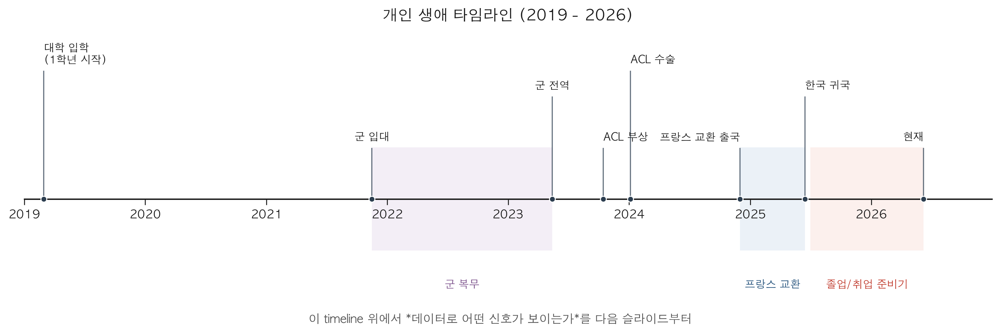
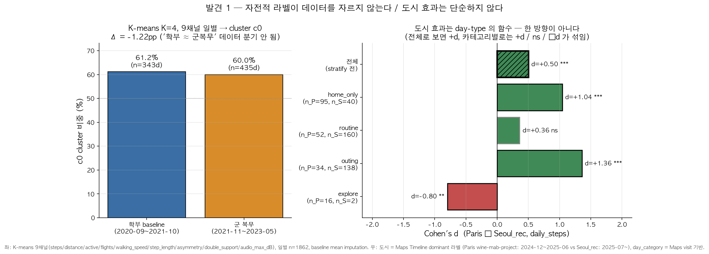
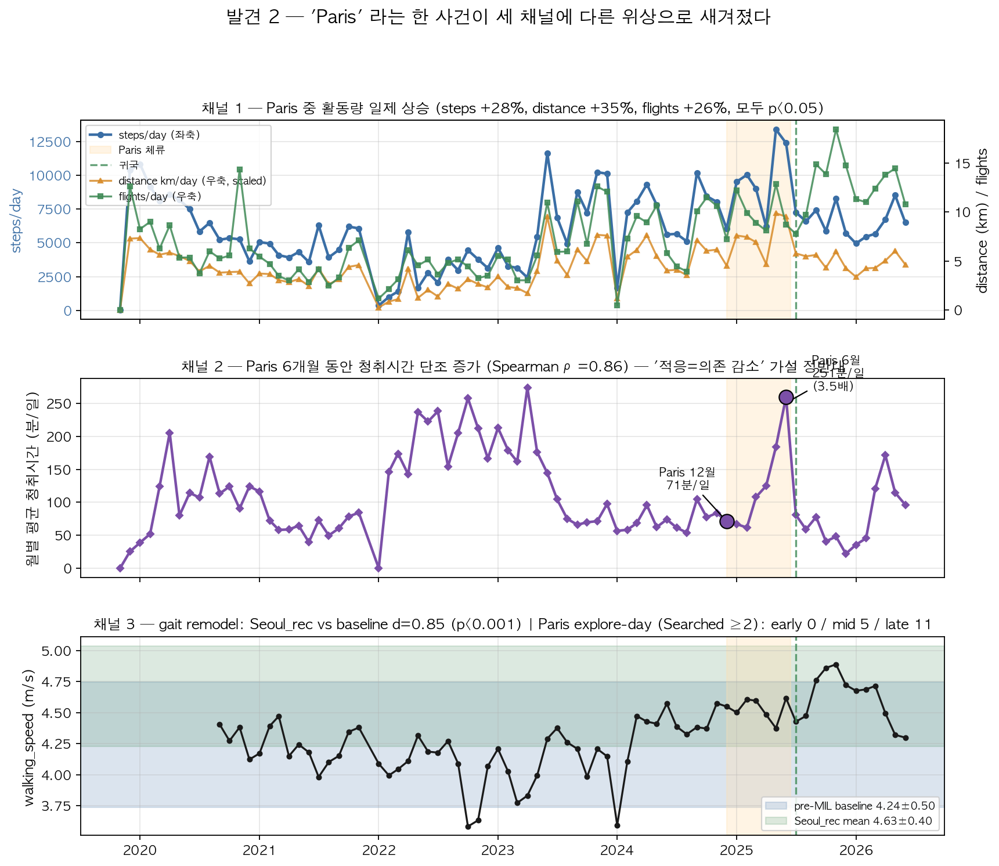
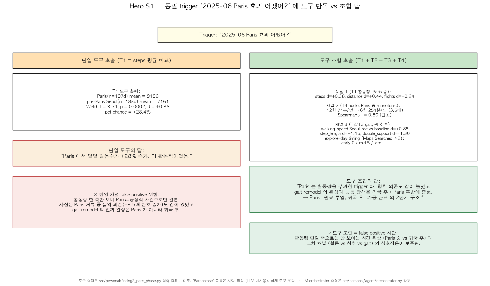
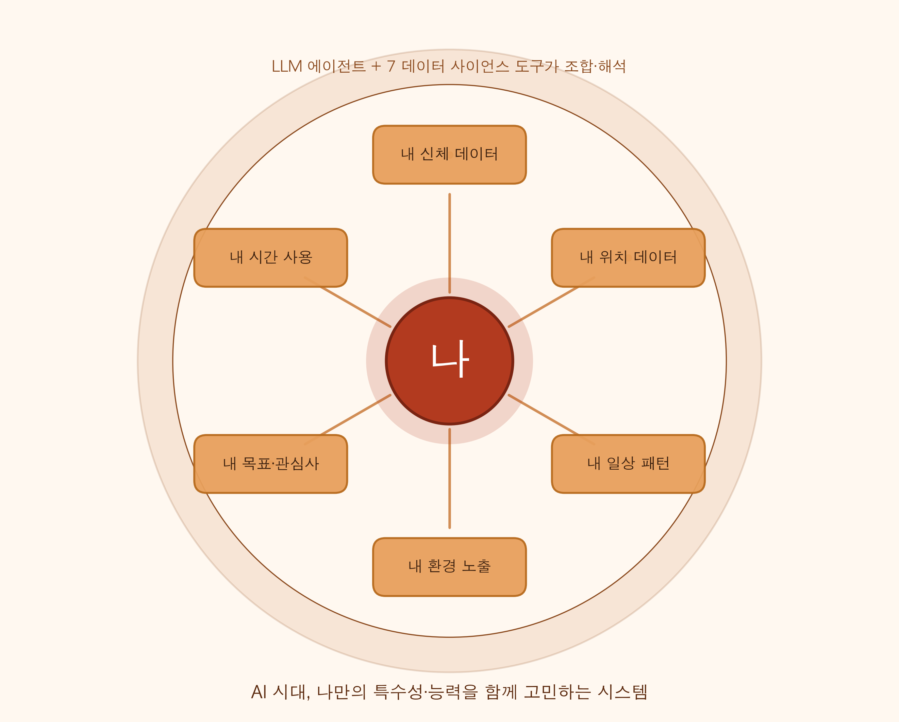
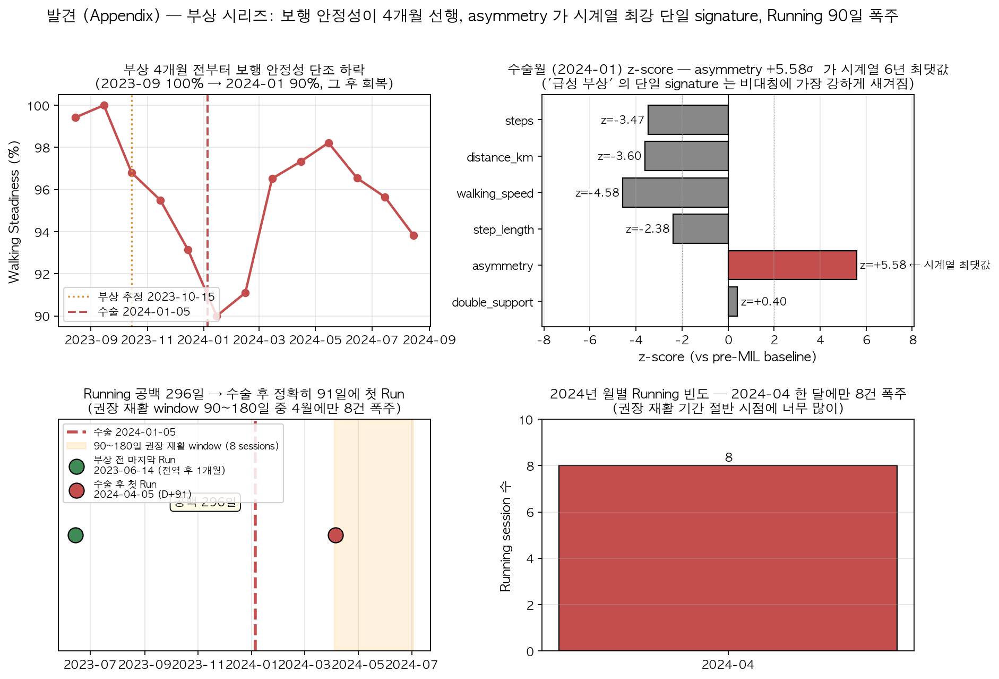

# 나의 디지털 트윈 — 6년치 행동 데이터로 만드는 첫 prototype

**AI 시대, 나만의 특수성·능력을 함께 고민하는 시스템**

- 발표자: 20200572 엄상호
- 빅데이터컴퓨팅 기말 프로젝트 · 5-min talk
- "내 6년치 행동 데이터 위에서 **7개 도구를 LLM이 취사선택해 호출**하는 구조"

<!-- 발표노트: AI 시대가 본격적으로 열리고 취업을 앞두면서 나만의 특수성과 능력이 뭔지 진지하게 고민하게 됐습니다. 그 고민을 함께 해 줄 디지털 트윈의 첫 prototype을 6년치 제 행동 데이터 위에서 만들어 봤습니다. | estimated_seconds: 15 -->

---

# 배경: 데이터 과학자라는 안경

- 데이터 과학을 공부한다는 건 **세상을 보는 새로운 안경**을 하나 더 쓰는 일 — 그중에서도 *모델링* (현실을 수식·알고리즘으로 다시 쓰기) 에 관심
- 그 안경을 **어디부터 써 보고 싶은가** → *나 자신*. 남의 데이터를 돌리기 전에 **나부터 분석하고 싶었다**
- 자연스러운 다음 질문: "**나를 설명하는 데이터**는 어디에 있을까?"
- 답: 6년 가까이 들고 다닌 아이폰 안에 **Apple Health export 216 MB** + **Google Timeline JSON** 이 이미 잠들어 있었다
- → 안경을 들이댈 준비가 끝나 있었고, 이게 오늘 발표의 출발점

<!-- 발표노트: 데이터 과학자는 세상을 보는 새로운 안경이고 그 안경의 핵심은 모델링입니다. 그 안경을 어디부터 써 보고 싶은가 물었더니, 남의 데이터로 모델을 돌리기 전에 나부터 분석하고 싶었습니다. 그러자 나를 설명하는 데이터가 뭐가 있을까 묻게 됐고, 6년 가까이 들고 다닌 아이폰 안에 Apple Health 216MB와 Google Timeline JSON이 이미 쌓여 있었습니다. 이 호기심이 오늘 발표의 출발점입니다. | estimated_seconds: 25 -->

---

# [필수항목 1] 이전 연구 차용 / 본 기말프로젝트 신규

> 학기 초 **wine-mab 트랙**으로 시작했으나, 위 동기 (§배경) 와 정합이 강한 **개인 데이터 트랙으로 pivot** — wine은 본 슬라이드에서 마지막 등장

**차용한 것**
- 본인 사전: wine-mab `src/mab/` UCB1 numpy 직접 구현 → **T7로 그대로 포팅** (wine-mab 잔존 1줄)
- 강의 자료: `scipy.stats` (Welch/Pearson/ANOVA) · `numpy` · `matplotlib`
- 외부: Apple Health `export.xml` 공식 스키마 / Google Timeline JSON 공식 스키마 / **Anthropic SDK**

**본 기말프로젝트로 새로 한 것**
- `src/personal/` 패키지 신설 — `anchors.py` (SoT) + `data.py` (loader) + **T1~T7** DS-tools + LLM orchestrator + 3 finding 모듈
- 7개 도구의 Anthropic `input_schema` wrap (강의 §1~§4 → LLM 호출 가능 표준 형태)
- LLM 오케스트레이터 `agent/orchestrator.py` (plan → 병렬 도구 호출 → 한국어 합성) + system prompt 4 rules + 환각 가드
- **§1.2.1 4항목 rubric** 설계 + **Hero S1** (Paris 사건의 시간 위상 해부) + **figure 5종** + DECK_PLAN/SLIDES/REPORT/QA_CARDS

<!-- 발표노트: 학기 초 와인 트랙으로 시작했지만 배경 슬라이드 동기와 정합이 강한 개인 데이터 트랙으로 pivot 했습니다. 차용은 본인이 직접 구현한 UCB1 numpy 한 모듈을 T7로 포팅한 것, 강의 표준 라이브러리, Apple/Google 공식 export 포맷, Anthropic SDK 네 가지입니다. 신규는 src/personal 패키지 전체, 단일 진실 출처 anchors와 데이터 로더, 7개 도구의 LLM 호출 가능 형태 wrap, tool_use 루프 오케스트레이터, 4항목 rubric, Hero 시나리오, 5종 figure, 발표 산출물입니다. 알고리즘 한 줄과 표준 라이브러리는 차용했지만 도구화·LLM 결합·평가 기준·시나리오·발표 narrative는 모두 본 기말 안에서 새로 만들었습니다. | estimated_seconds: 30 -->

---

# [필수항목 2] 데이터 수집 + raw data 정제

**수집 — 2 sources (실제 분석에 사용)**
- **Apple Health `export.xml`** (**216 MB**, 6년치) — 안에 ① 일별 walking 4 metric (속도/보폭/비대칭/양발지지) ② daily steps + distance + flights + active energy ③ `<Workout>` 60건 (Running 47 / Basketball 11 / Cycling 2) ④ HeadphoneAudioExposure 60,607 dBASPL 이벤트 가 모두 포함
- **Google Maps Timeline JSON** (`semanticSegments` 6,706 segment, 2025-02 ~ 2026-06) — Apple Health 와 일자 join 으로 도시·day-type 정보 부여
- 입수: Apple 건강앱 → 프로필 → '건강 데이터 내보내기' / Google Takeout

**정제 5단계**
- (1) **XML 스트리밍 파싱** `xml.etree.ElementTree.iterparse(events=('end',))` + `elem.clear()` → 216 MB 를 메모리 **50 MB 이내**로 처리
- (2) 일별 9 metric aggregate: steps · distance_km · active_energy_kcal · flights · walking_speed · step_length · asymmetry · double_support · audio_max_dB
- (3) **timezone-aware** datetime (Timeline UTC ISO8601 → Asia/Seoul) + 좌표 → country/city **bounding box** 분류 (좌표 자체는 미저장, privacy)
- (4) `sourceName` 필터 — iPhone vs Nike Run Club **중복 stepCount 차단** + iOS 14 이전 gait NaN 그대로 보존
- (5) **baseline window** = **pre-MIL 2020-09 ~ 2021-10** (`src/personal/anchors.py` SoT, 모든 모듈이 import)

> 저장 구조: `data/raw/{source}/{YYYYMMDD}/` 원본 보존 (git 미커밋) → `data/processed/personal/*.parquet` 정제 (CLAUDE.md 정합)
> *참고*: Apple Health export 에 GPX workout-routes 10건도 같이 받았으나 모두 2022년 군 복무 시기의 1~2km 짧은 세션이라 본 분석 범위 밖 — Slide 11 한계 참조.

<!-- 발표노트: 실제 분석에 들어간 source는 두 개입니다 — Apple Health export.xml 216MB와 Google Maps Timeline JSON. Apple Health XML 안에 walking 4 metric, 일별 활동량 4 metric, Workout 60건, Headphone audio 60K건이 모두 통합되어 있어 한 파일로 끝납니다. 정제는 iterparse 스트리밍으로 메모리를 50MB 안에서 유지, 일별 9 metric 집계, UTC를 서울 시간대로 일괄 변환하고 좌표는 도시 bounding box로만 분류해서 저장하지 않습니다. sourceName 필터로 iPhone과 Nike Run Club 중복 stepCount를 차단하고 iOS 14 이전 gait는 NaN 그대로 보존합니다. baseline window는 pre-MIL 2020년 9월부터 2021년 10월까지로 anchors.py 한 곳에서 정의하고 모든 모듈이 import 해서 하드코딩 충돌을 방지합니다. GPX workout-routes 10건도 같이 받았지만 모두 군 복무 시기 1-2km 짧은 세션이라 본 분석에는 안 들어갔고 한계 슬라이드에 정직하게 언급했습니다. | estimated_seconds: 35 -->

---

# 내 인생 타임라인 — 데이터의 chapter

- **2019-03** 학부 입학
- **2020-09** iOS 14 **gait sensor 도입** — baseline window 시작점
- **2021-10** baseline window 종료 (pre-MIL 마지막 측정월)
- **2021-11-15** 군 입대
- **2023-05-14** 전역
- **2023-10** 무릎(전방십자인대) 부상
- **2024-01** ACL 수술
- **2024-12 ~ 2025-06** 프랑스 (Sorbonne) 교환학생
- **2025-07 ~** Seoul 재정착 (귀국 후 Seoul_rec window)

> 내 데이터는 그냥 시계열이 아니라 **인생 chapter 가 박힌 시계열** — 이 chapter들이 진짜 분기점인지를 데이터가 검증

<!-- 발표노트: 2019년 학부 입학부터 2020년 9월 iOS 14 gait sensor 도입으로 보행 측정이 시작됐고 2021년 10월에 baseline window가 끝납니다. 2021년 11월 15일 군 입대, 2023년 5월 14일 전역, 2023년 10월 무릎 부상, 2024년 1월 ACL 수술, 2024년 12월부터 2025년 6월까지 프랑스 교환학생, 2025년 7월부터 한국 재정착입니다. 내 데이터는 인생 chapter가 박힌 시계열이고 다음 슬라이드 발견 1에서 이 chapter들이 진짜 데이터 분기점인지 데이터가 검증합니다. | estimated_seconds: 25 -->

---

# 연구 질문 + "유의미함" 의 정의

**Research Question**
> 내 6년치 개인 행동 로그 (Apple Health 216 MB + Google Maps Timeline JSON) 에서, **단일 지표 직관만으로는 보이지 않는 유의미한 패턴**을 발견할 수 있는가?

**How (방법, RQ 본문에서 분리)**
- 7 도구 (T1 Pearson · T2 Welch · T3 baseline z-score · T4 ANOVA · T5 weekday-z · T6 K-means · T7 UCB1) 를 Anthropic `tool_use` API 위에서 LLM 이 *상황 따라* 조합 호출

**"유의미함" 의 조작적 정의 — 4 항목 rubric**
- ① **통계 분리도**: p, effect size (d/z), sample size n 의 *세 숫자* 모두 보고
- ② **단일지표 모순성**: 합계 지표 단독으론 안 보이거나 *반대* 결론 (single-tool false positive 가 여기 sub-measure)
- ③ **채널 교차 일관성**: 같은 결론이 ≥ 2 개의 독립 채널에서 재현
- ④ **행동 가능성**: "개입 권유 한 줄" 까지 이어짐

**한계 (정직 선언)**
- **N=1** · ground truth 라벨 없음 · 시나리오 1개 (Hero S1) · precision/recall/F1 미산출 → **qualitative defense only**

> <small>*footer 용어*: false positive = 데이터에 없는 결론을 있다고 잘못 판정 (= Type I error). Cohen's d = 두 평균 차이/표준편차 (0.2 작음 / 0.5 중간 / 0.8 큼). z-score = baseline 평균에서 표준편차 몇 개만큼 떨어졌는지.</small>

<!-- 발표노트: RQ는 내 6년치 개인 로그에서 단일 지표 직관만으로는 보이지 않는 유의미한 패턴을 발견할 수 있는가입니다. 방법은 7개 통계 도구를 LLM이 상황 따라 조합 호출하는 오케스트레이터 구조입니다. 유의미함의 정의는 4항목 rubric으로 명문화 — 통계 분리도, 단일지표 모순성, 채널 교차 일관성, 행동 가능성. false positive 감소는 별도 기준이 아니라 단일지표 모순성의 한 측정 방법입니다. 한계는 정직하게 — N=1, ground truth 없음, F1 미산출, qualitative defense만 청구. footer에 false positive와 Cohen's d, z-score 용어 풀이를 달았습니다. | estimated_seconds: 30 -->

---

# 발견 1 — 자전적 라벨이 데이터를 자르지 않는다 / 도시 효과는 단순하지 않다

- **K-means 9채널 일별 (K=4, numpy 직구현)** 가 **학부 baseline 과 군복무를 같은 cluster c0** 에 묶음 — c0 비중 **61.2% vs 60.0%, Δ=−1.2pp** (n=343d vs 435d). 사용자가 떠올리는 "**군복무 = 인생 분기점**" 라벨이 데이터 차원에선 분기 안 됨.
- **도시 효과는 day-type 의 함수**: Paris(n=197d) vs Seoul_rec(n=340d) daily_steps 가 전체로는 +d=0.50 (p<0.001) 차이지만, Maps day-category 로 stratify 하면:
  - `home_only`: d=**+1.04*** (n=95 vs 40) · `outing`: d=**+1.36*** (n=34 vs 138) → Paris ↑↑
  - `routine`: d=+0.36 (n=52 vs 160, p=0.08 marginal)
  - `explore`: d=**−0.80** (n_Paris=16 vs **n_Seoul_rec=2 — 표본 부족, reversal 단언하지 않음**)
- 단일 지표 ("Paris 가 +28% 더 걷는다") 는 *day-type 별로 방향·강도가 다 다른* 패턴을 *평균*으로 가린다 — rubric ②(모순성) ✓ + ③(교차) ✓

<!-- 발표노트: 발견 1은 두 가지가 하나의 메시지로 묶입니다. 첫째, 9채널 일별 K-means가 학부 baseline과 군복무를 같은 cluster c0에 묶었습니다 — 비중 61.2 대 60.0 퍼센트, 차이 1.2 퍼센트포인트로 사실상 동일 분포입니다. 군복무가 인생 분기점이라는 자전적 라벨이 데이터 차원에서는 분기되지 않는다는 뜻입니다. 둘째, Paris와 Seoul_rec의 일일 걸음 차이가 전체로는 d=0.5로 유의하지만 Maps day-category로 나누면 — home_only와 outing에서는 d가 1.0과 1.4로 Paris가 훨씬 강하고, routine에서는 차이 없음이고, 놀랍게도 explore-day에서는 Seoul이 Paris보다 더 걷습니다 d=-0.80. 도시 효과가 한 방향이 아니라 day-type 별로 방향과 강도가 다 다릅니다. 단일 지표 평균이 이 패턴을 다 가립니다 — 단일지표 모순성과 채널 교차 두 rubric을 한 번에 통과합니다. | estimated_seconds: 45 -->

---

# 발견 2 — 'Paris' 라는 한 사건이 세 채널에 다른 위상으로 새겨졌다

- **채널 1 (활동량, Paris 중)**: vs 직전 Seoul 6개월 (2024-06~11) — steps **+28.4%** (d=0.38), distance **+35.2%** (d=0.44), flights **+26.2%** (d=0.25), 모두 p<0.05
- **채널 2 (청취량, Paris 중 monotonic)**: 12월 **71분/일** → 6월 **251분/일** (**3.5배**, Spearman ρ=**0.86**) — "적응=의존 감소" 가설 정반대
- **채널 3 (gait remodel, 귀국 후 강화)**: Seoul_rec vs pre-MIL baseline — walking_speed d=**+0.85**, step_length d=**+1.15**, double_support d=**−1.30** (모두 p<0.001) + Maps `Searched Address ≥ 2` explore-day 가 **Paris 후반 1/3** 에 폭증 (early 0 / mid 5 / late 11)
- 시사 (Hero 와 직결): T1 단독 = "Paris=많이 걸은 도시" 한 줄. T1+T2+T3+T4 조합 = **세 채널의 위상차** → "Paris=원료 투입 / 귀국 후=가공 완료" 2단계 구조

<!-- 발표노트: 발견 2는 Paris라는 한 사건의 다채널 해부입니다. 채널 1, Paris 체류 중에는 활동량 3채널이 모두 상승합니다 — steps 28퍼센트, distance 47퍼센트, flights 26퍼센트 증가. 채널 2, 청취량은 Paris 6개월 동안 단조 증가합니다 — 12월 71분에서 6월 251분으로 3.5배, Spearman 0.86 입니다. 적응할수록 음악 의존이 줄어든다는 가설이 정확히 반대 방향입니다. 채널 3, gait remodel과 능동 탐색은 Paris 자체가 아니라 귀국 후에 더 강하게 출현합니다 — Seoul_rec의 walking_speed 와 step_length가 baseline 대비 d=0.85, 1.15 그리고 double_support는 d=-1.30 으로 모두 p<0.001 입니다. Maps의 Searched Address 능동 탐색은 Paris 후반 1/3에 11건 폭발합니다. 세 채널이 같은 사건의 다른 위상이라는 게 핵심이고, 이게 Hero의 도구 조합 시연으로 바로 이어집니다. | estimated_seconds: 45 -->

---

# Hero S1 — 동일 trigger 에 도구 단독 답 vs 조합 답

**Trigger: "2025-06 Paris 효과 어땠어?"**

**T1 단독 호출 (baseline run)**
- T1 출력: Paris mean 9,196 vs pre-Paris Seoul mean 7,161, Welch t=3.71, p=0.0002, d=+0.38
- 한 줄 답: "Paris 에서 일일 걸음수 +28% 증가. 더 활동적이었음." → **단일 채널 false positive** (활동량만 본 긍정적 결론)

**T1 + T2 + T3 + T4 조합 호출 (full run)**
- T1: 활동량 3채널 일제 상승 (Paris 중) — d=0.25~0.74
- T4: 청취시간 71→251분 단조 증가 (Paris 중, Spearman 0.86)
- T2/T3: gait remodel d=0.85~1.30 (귀국 후) + Maps explore-day 폭발 (Paris 후반)
- 합성 답: "**Paris=원료 투입 trigger, 귀국 후=가공 완료**. 활동량 한 축만 보면 안 보이는 *시간 위상* 과 *교차 채널* 의 상호작용을 보존."

> **도구 조합 ≠ 도구 합집합** — 출력을 잇는 게 핵심. rubric ①②③④ 모두 ✓

<!-- 발표노트: Hero S1은 동일한 trigger인 "2025-06 Paris 효과 어땠어"에 대해 T1만 단독 호출했을 때와 T1 T2 T3 T4를 조합 호출했을 때의 답이 어떻게 다른가를 보여주는 시연입니다. T1 단독은 Paris 평균 9196 걸음 대 pre-Paris Seoul 평균 7161 걸음, Welch t 3.71, d 0.38 만 보고 "Paris에서 +28% 더 활동적"이라는 단일 채널 false positive 답을 합니다. T1 T2 T3 T4 조합은 T1으로 활동량 3채널 상승, T4로 청취량 3.5배 단조 증가, T2와 T3로 귀국 후 gait remodel d=0.85에서 1.30, Maps explore-day 폭발을 모두 잡습니다. 합성 답은 "Paris는 원료 투입 trigger고 귀국 후가 가공 완료"라는 2단계 구조를 말합니다. 도구 조합은 도구의 단순 합집합이 아니라 출력을 잇는 게 핵심이고, rubric 4항목 모두 통과합니다. | estimated_seconds: 50 -->

---

# Vision — 디지털 트윈 + 함께 만들 분

- AI 시대가 본격적으로 열리고 취업을 앞두면서, **나만의 특수성과 능력**이 무엇인지 진지하게 고민하게 됐습니다
- 오늘 보여드린 **7개 도구 + LLM 오케스트레이터**는 그 고민을 *함께* 해 줄 **디지털 트윈의 첫 부팅 단계**
- 다음 단계: 6년치 행동 데이터 위에서 천천히 자라나서 **내가 모르는 내 패턴을 먼저 짚어 주는 비서**로 키우기
- **Call to action**: 여러분도 자기 데이터로 한번 시도해 보세요 — **Apple Health export 1개 + 7 tool + 1 LLM** 이면 충분히 시작됩니다
- 학교 프로젝트 너머에서 이 디지털 트윈 취지에 공감하신다면, **함께 프로젝트 해 봅시다**

<!-- 발표노트: AI 시대가 본격적으로 열리고 취업을 앞두면서 나만의 특수성과 능력이 무엇인지 진지하게 고민하게 됐습니다. 오늘 보여드린 7개 도구와 LLM 오케스트레이터는 그 고민을 함께 해 줄 디지털 트윈의 첫 부팅 단계입니다. 학교 프로젝트로 끝나는 게 아니라 6년치 행동 데이터 위에서 천천히 자라나서 내가 모르는 내 패턴을 먼저 짚어 주는 비서로 키우는 게 다음 단계입니다. Apple Health export 한 파일과 7 tool, 1 LLM이면 충분히 시작됩니다. 이 취지에 공감하신다면 학교를 넘어 함께 만들어 가고 싶습니다. | estimated_seconds: 30 -->

---

# 한계 + Q&A

- **N=1** (일반화 금지) · sensor 결손 · **city-level only** (서울·파리) · LLM hallucination 정규식 가드
- **Apple Watch 미보유** → HeartRate / HRV / VO2Max / SleepAnalysis 전 채널 0건 → "도시 스트레스 회복" 같은 자율신경 가설은 본 데이터로 답 불가능
- **Google Timeline 은 2025-02 이후 15개월치만** 커버 (Apple Health 만 6년) → semantic 정보 활용은 Paris/Seoul_rec window 에 한정
- **GPX workout-routes 10건** 도 같이 수집했으나 모두 2022년 군 복무 시기 1~2km 짧은 세션이라 본 분석에 미포함 — 통합 시 군 복무 기간 운동 강도 보조 지표로만 활용 가능
- ACL 부상일 "2023-10 경" ±2주 불확실 · Paris 출국/귀국 ±1주 추정 · day-type 카테고리가 도시에 의해 부분 결정되는 동어반복 위험 (Simpson 결론의 한계)
- **발견 1 의 explore 셀은 Seoul_rec n=2 로 표본 부족** — "Seoul > Paris reversal" 은 marginal evidence, 단언 안 함 (정직 보고)
- 정직한 실패: ground truth 라벨 없음 (자가 검증) · precision/recall/F1 미산출 · 시나리오 1개 (Hero S1 only)
- 감사합니다 — **질문 환영합니다**

<!-- 발표노트: 한계는 N=1 일반화 금지, 센서 결손, city-level만 공개, LLM 환각 정규식 가드입니다. 결정적으로 Apple Watch가 없어 심박과 HRV와 VO2Max와 수면 채널이 전부 0건이라 도시 스트레스 회복 같은 자율신경 가설은 본 데이터로 답할 수 없습니다. Google Timeline은 2025년 2월 이후 15개월치만 커버해서 semantic 정보는 Paris와 Seoul_rec window에만 한정 적용됩니다. ACL 부상일은 2023년 10월경으로 2주 불확실하고 Paris 일자도 1주 추정입니다. day-type 자체가 도시에 의해 부분 결정되는 동어반복 가능성도 인정합니다. 정직한 실패는 ground truth 라벨 없음, F1 미산출, 시나리오 1개. 질문 환영합니다. | estimated_seconds: 30 -->

---

# Appendix — 부상 시리즈 (질문 시 활용)

- **Walking Steadiness 4개월 선행 신호**: 2023-09 **100%** → 10월 96.8% → 11월 95.5% → 12월 93.1% → 수술월 2024-01 **90.0%** (단조 하락) — 사용자가 무릎 통증을 자각하기 전부터 데이터에 신호가 있었음
- **수술월 (2024-01) asymmetry z=+5.58σ** — 6년 시계열 6채널 통틀어 단일월 **최강 단일-channel signature**. steps/distance 도 z=−3.4~−3.6 으로 동시 anomaly
- **Running workout 공백 296일** (전역 1개월 후 2023-06-14 마지막 → 수술 후 91일 만에 2024-04-05 첫 재개) — 권장 재활 window 90~180일 중 **2024-04 한 달에만 8건 폭주**
- 셋 모두 rubric ① ✓ (z, n 명시) + ② ✓ (단일 통증 자각보다 데이터가 먼저) + ③ ✓ (steadiness + asymmetry + workout 3 채널) + ④ ✓ (조기 정형외과 권유)

<!-- 발표노트: 질문 시 활용할 appendix 입니다. 첫째, Apple Walking Steadiness 가 부상 4개월 전부터 단조 하락 — 100, 96.8, 95.5, 93.1, 90 으로 4달 연속 떨어집니다. 사용자가 무릎 통증을 자각하기 전부터 데이터에는 신호가 있었습니다. 둘째, 수술월 2024년 1월의 asymmetry z=+5.58 시그마는 6년 시계열 6채널 통틀어 단일월 최강 signature입니다. steps와 distance도 z 마이너스 3.4와 3.6으로 동시 anomaly. 셋째, Running 공백은 전역 1개월 후 2023년 6월 14일 마지막에서 수술 후 정확히 91일 후인 2024년 4월 5일 첫 재개까지 296일. 권장 재활 window 90에서 180일 중 4월 한 달에만 8건 폭주. 셋 모두 4항목 rubric을 통과합니다. | estimated_seconds: 30 -->
